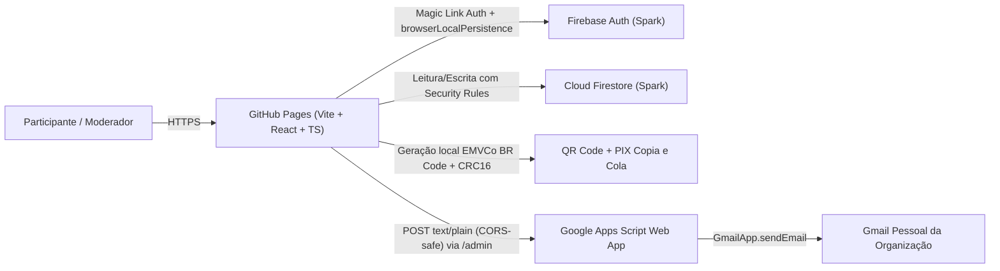

# Arquitetura Técnica — MegaCorn

Documentação detalhada da arquitetura, modelo de dados no Firestore, segurança/PII, algoritmos e integrações do **MegaCorn**.

---

## 1. Visão Geral dos Componentes

- **Roteamento SPA no GitHub Pages:** utiliza `HashRouter` (`#/regras`, `#/minha-cota`, `#/placar`, `#/jogos`, `#/admin`) e `base: './'` no `vite.config.ts`, evitando erros 404 em refresh direto e preservando query params (`?convite=...`, `?oobCode=...`) na raiz da URL.
- **Abstração de Dados (`DataService`):** `src/services/index.ts` escolhe automaticamente `firebaseAdapter.ts` (quando `VITE_FIREBASE_*` existem) ou `demoAdapter.ts` (fallback local em `localStorage`).

---

## 2. Modelo de Dados no Firestore e Isolamento de PII

Todos os dados sensíveis (e-mail pessoal e CPF opcional) ficam isolados em `users/{uid}`. Nenhuma coleção lida por outros participantes armazena PII sensível.

| Caminho Firestore | Conteúdo | Leitura | Escrita |
| :--- | :--- | :--- | :--- |
| `config/public` | Nome, edição (`2027`), preço cota (`40.32`), total (`100`), máx./pessoa (`3`), `currentPhase`, 4 datas da timeline, `organizerContact`, `quotaPriceRationale`, `bannerMessage`, `rulesExtraNotes`, `flags` | Público (`true`) | Moderadores |
| `config/payment` | `pixKey`, `merchantName`, `merchantCity`, `instructions` | `hasActiveProfile()` ou Moderadores | Moderadores |
| `config/admin` | `appsScriptUrl`, `appsScriptSecret`, `moderatorEmails`, `activeInviteCode` | **Somente Moderadores** | Moderadores |
| `inviteCodes/{code}` | `{ active: boolean, updatedAt: number }` | `get`: público (exact match); `list`: Moderadores | Moderadores |
| `users/{uid}` | **PII:** `email`, `cpf` (opcional, 11 dígitos), `displayName`, status aprovação/PIX/estorno, `assignedTicketNumbers`, `receiptDelivered`, `txid`, `isModerator`, `createdAt` | Próprio `uid` ou Moderadores (`list`: só Moderadores) | Criação com convite ativo + validações rígidas; atualização restrita; `delete`: Moderadores |
| `board/{uid}` | **Zero e-mail / zero CPF:** `displayName`, cotas pedidas/pagas/finais, status PIX/estorno, `assignedTicketNumbers`, `receiptDelivered`, `createdAt` | `hasActiveProfile()` (se `boardVisible`) ou Moderadores | Moderadores (criação/exclusão); próprio `uid` (apenas edição permitida antes do PIX) |
| `stats/summary` | `{ approvedCount, pendingApprovalCount }` (contagem anônima sem nomes) | `hasActiveProfile()` ou Moderadores | Moderadores ou incremento atômico `+1` no batch de criação de `users/{uid}` |
| `games/{gameId}` | `{ label, numbers: number[], notes, createdAt, createdBy }` | `hasActiveProfile()` (se `gamesVisible`) ou Moderadores | Moderadores |
| `drawResult/current` | `{ numbers: number[], updatedAt, updatedBy }` | `hasActiveProfile()` (se `gamesVisible`) ou Moderadores | Moderadores |
| `auditLog/{logId}` | `{ action, actorEmail, targetName, details, createdAt }` | Moderadores | Moderadores + participantes ativos apenas nos próprios eventos permitidos (`Cadastro realizado`, `Perfil/cotas editados`, `Aviso de PIX enviado`, sem CPF; append-only: `update`/`delete`: `false`) |

### Garantias de Segurança em `firestore.rules`
- **`hasActiveProfile()`:** exige conta autenticada com documento em `users/{uid}` cujo `approvalStatus` seja `'pending'` ou `'approved'` (impede contas Auth criadas sem código de convite ou usuários recusados/cancelados de lerem Placar, Jogos, Contadores ou Chave PIX).
- **Anti-fura-fila:** `createdAt` na criação de `users/{uid}` precisa estar dentro de ±5 minutos de `request.time.toMillis()`, e é imutável no `update`.
- **Limites no servidor:** `requestedQuotas` validado como inteiro entre `1` e `maxQuotasPerPerson`; limites de caracteres em `displayName` (1..80), `cpf` (<=11) e `paymentNote` (<=200).
- **Imutabilidade:** o participante nunca pode alterar `uid`, `email`, `txid`, `inviteCodeUsed`, `createdAt`, `isModerator`, `approvalStatus`, `paidQuotas`, `finalQuotas`, `refund*`, `assignedTicketNumbers` nem `receiptDelivered`.
- **Retrocompatibilidade:** campos adicionados posteriormente (`assignedTicketNumbers`, `receiptDelivered`) usam `.get(campo, default)` nas regras para não quebrar documentos antigos.

---

## 3. Algoritmos Centrais

### A. Equidade em Camadas & Estornos (`src/lib/equity.ts`)
- Ordena elegíveis por `createdAt` crescente (desempate por `uid`).
- Distribui em rodadas (`layer = 1 .. maxRequested`): primeiro a 1ª cota de todos; depois a 2ª cota de quem pediu `>= 2`; depois a 3ª, até zerar `totalQuotas`.
- Participantes que terminam com `allocatedQuotas === 0` (acima de `totalQuotas` pessoas únicas) recebem `isWaitlisted = true` e `waitlistPosition` sequencial.
- No fechamento (`closePoolAndComputeRefunds`), roda a alocação sobre os **aprovados com PIX confirmado** (`paidQuotas > 0`), congela `finalQuotas` e calcula `refundQuotas = paidQuotas - finalQuotas` e `refundAmount = refundQuotas * quotaPrice`.

### B. Evolução em 8 Fases (`src/lib/phases.ts`)
Ordem fixa em `POOL_PHASES`:
1. `registration` — Fase de cadastro (`registrationDeadline`)
2. `registration_closed` — Cadastro fechado
3. `consolidating_payments` — Consolidando pagamentos (`paymentDeadline`)
4. `bet_placed` — Aposta feita (`betPlacementDate`) ← **libera bilhetes e entrega em mãos**
5. `delivering_tickets` — Bilhetes sendo entregues
6. `draw` — Sorteio (`drawDate`)
7. `claiming_prize` — Resgatar prêmio
8. `retired` — Aposentar

`canManageTickets(phase)` retorna `true` somente quando `getPhaseIndex(phase) >= getPhaseIndex('bet_placed')`. Verificado na UI do `/admin` e nos adapters (`firebaseAdapter.ts` e `demoAdapter.ts`).

### C. PIX Estático BR Code (`src/lib/pix.ts`)
- Gera string EMVCo localmente (`000201...6304<CRC16>`) com `br.gov.bcb.pix`, chave PIX, valor exato (`54`), recebedor (`59`, máx. 25 chars sem acentos), cidade (`60`, máx. 15 chars), `txid` interno (`62 -> 05`, máx. 25 alfanuméricos) e CRC16-CCITT (`0x1021`).
- Renderiza QR Code no navegador via pacote `qrcode`.

### D. Probabilidades & Conferidor Mega-Sena (`src/lib/lottery.ts`)
- Base: $\binom{60}{6} = 50.063.860$ combinações.
- Para volante de $k \in [6, 20]$ dezenas:
  - **Sena (6):** $\binom{k}{6} / \binom{60}{6}$
  - **Quina (5):** $\binom{k}{5}\binom{60-k}{1} / \binom{60}{6}$
  - **Quadra (4):** $\binom{k}{4}\binom{60-k}{2} / \binom{60}{6}$
- **Acumulado do bolão:** detecta se algum par de volantes compartilha $\ge 6$ dezenas; sem sobreposição, soma exata das combinações para Sena; para Quina/Quadra (ou com sobreposição), usa $1 - \prod (1 - p_i)$.
- **Conferidor:** contabiliza múltiplas premiações em volantes de 7+ dezenas segundo regra oficial da Caixa ($\binom{\text{hits}}{r}\binom{k-\text{hits}}{6-r}$).

### E. Estratégia de Sessão, Magic Link e Convite na URL (`src/lib/session.ts`)
- Firebase Auth com `browserLocalPersistence`.
- Cookies auxiliares não sensíveis + `localStorage`:
  - `megacorn_signin_email` (1h): completa login automático ao retornar do Magic Link no mesmo navegador;
  - `megacorn_session_hint` (30d): pré-preenche e-mail na tela de login;
  - `megacorn_invite_code` (7d): preserva o código vindo de `?convite=`, `?invite=` ou `?code=` (tanto em `location.search` quanto no hash) durante toda a jornada até `/minha-cota`.
- `MagicLinkHandler.tsx` cobre retorno automático, outro dispositivo (pede confirmação de e-mail) e link expirado/já usado (botão reenviar com cooldown de 60s).

### F. Integração Google Apps Script (`src/lib/appsScript.ts` + `apps-script/Code.gs`)
- A UI do `/admin` envia `POST` com `Content-Type: text/plain;charset=utf-8` (evita preflight CORS `OPTIONS` no Apps Script).
- O `Code.gs` valida `data.secret === PropertiesService.getScriptProperties().getProperty('MEGACORN_SECRET')` e dispara via `GmailApp.sendEmail` em texto puro sem emojis de 4 bytes.
